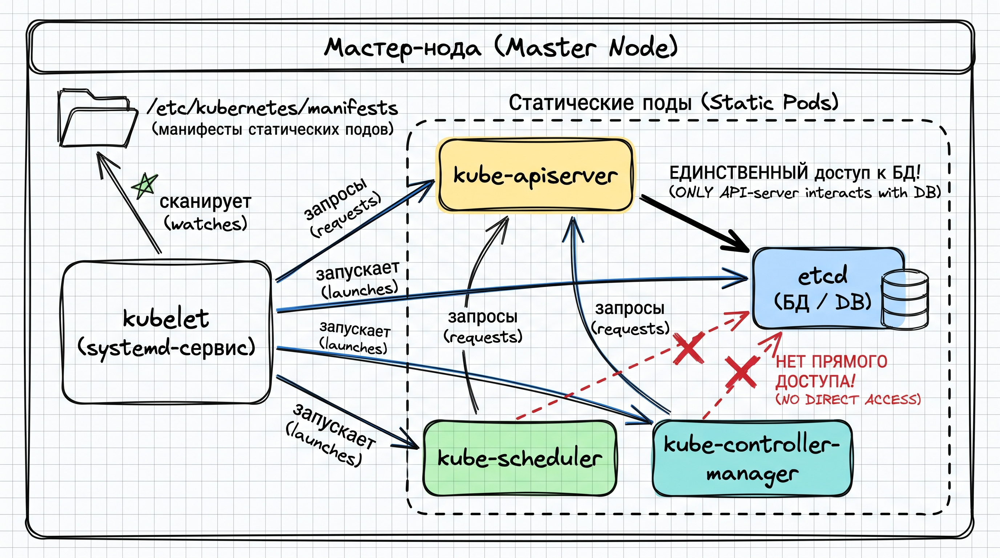

# K8s Control Plane Internals & Disaster Recovery

A deep-dive sandbox for exploring the physical architecture of a vanilla Kubernetes cluster. 
The goal of this module is to move beyond Kubernetes abstractions (Deployments, Helm charts) and understand the system at the OS level: static pods, systemd services, etcd consensus, and raw I/O.

## 🏗 Architecture & Mental Model

*(Draw an Excalidraw diagram here showing kubelet managing static pods and apiserver talking to etcd)*

Unlike managed K8s (EKS, GKE) or heavy enterprise distributions (OKD, OpenShift), this environment is bootstrapped via `kubeadm` to expose the raw Control Plane. There is no magic: the Control Plane is simply a set of standard containers managed by a local `kubelet` watching a specific directory on the master node.

---

## 🧪 Chaos Labs & Post-Mortems

This directory documents four hardcore disaster recovery simulations performed on a multi-node cluster.

### Lab 1: Anatomy of Static Pods (Control Plane Assassination)
**Hypothesis:** The Kube-APIServer is just a static pod. If the process is forcefully killed at the OS level, `kubelet` will detect the state mismatch and recreate it without cluster corruption.
* **Execution:** SSH into the master node, locate the `kube-apiserver` PID via `crictl ps`, and execute `kill -9 <PID>`.
* **Result:** `kubelet` automatically respawns the container from `/etc/kubernetes/manifests/kube-apiserver.yaml`. API downtime is limited to container startup time (~5-10 seconds).

### Lab 2: etcd Surgery (Backup & Total Restore)
**Hypothesis:** Kubernetes is completely stateless. 100% of the cluster's memory resides in `etcd`. Wiping the etcd data directory and restoring from a snapshot will perfectly rollback the cluster state.
* **Execution:**
  1. Took an `etcdctl` snapshot using the cluster's PKI certificates (`ca.crt`, `server.crt`, `server.key`).
  2. Deployed a dummy workload (Nginx pod).
  3. Stopped the Control Plane by moving static pod manifests to `/tmp`.
  4. Wiped `/var/lib/etcd` and restored the database from the snapshot using `etcdctl snapshot restore`.
* **Result:** Upon restarting the Control Plane, the dummy workload vanished. The cluster was successfully rolled back in time.

### Lab 3: Manual TLS Certificate Rotation
**Hypothesis:** Cluster outages are frequently caused by expired PKI certificates. Manually rotating them forces an understanding of the K8s trust chain.
* **Execution:** Checked expiration via `kubeadm certs check-expiration`. Forced a manual renewal using `kubeadm certs renew all`, followed by an API server restart to load the new certs into memory. Re-generated the `admin.conf` kubeconfig.
* **Result:** 100% uptime maintained post-rotation.

### Lab 4: Network Blackout & Node Eviction
**Hypothesis:** If a worker node is completely isolated from the API server via `iptables`, the Controller Manager will eventually mark the node as `NotReady` and evict its workloads to healthy nodes.
* **Execution:** Dropped all outgoing traffic to `6443` on a worker node using `iptables -A OUTPUT -p tcp --dport 6443 -j DROP`.
* **Result:** Node Status went to `NotReady` after the heartbeat timeout. Pod eviction triggered according to `pod-eviction-timeout` settings. Once the firewall rule was flushed, kubelet re-synced the state gracefully.

---
**Author:** Aleksandr Poludin | Data Platform Engineer